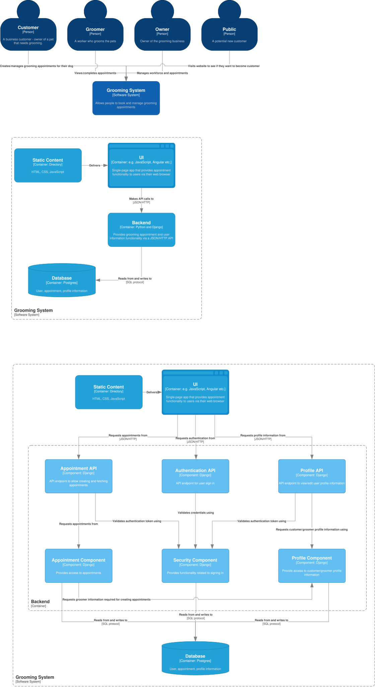

# User Stories & Acceptance Criteria
1. As an **owner**, I want to **see everyone's schedule** so I can **determine availability**.
    - On the schedule view, the owner sees everyone's appointments for the day
2. As an **owner**, I want to **be able to add/remove/edit a groomer** so I can **manage the workforce**.
    - Clicking the add button brings up a form to create a new user.
    - Saving the new user creates an account for a new groomer.
    - Clicking a delete button next to a groomer removes their account.
    - Editing the groomer brings up a form to modify the groomer information.
    - Only users with the owner permission should perform any changes
3. As an **owner**, I want to **be able to change prices for various services** so I can **always have up-to-date pricing**.
    - Editing a service's price updates the listing
    - Only the owner can update the price
    - Services should be returned in alphabetical order
    - Can click delete button to remove service
    - Can click add button to add service
4. As a **groomer**, I want to **set my availability schedule** so I can **let customers know when available appointments are**.
    - An groomer's schedule is displayed in a weekly view
    - An groomer can edit their schedule - selecting days and hours to work
5. As a **groomer**, I want to **be able to update notes about dogs** so I can **provide a more personalized service and note likes/dislikes**.
    - Under a given dog's profile, a listing of notes is displayed
    - An groomer can add a note, saving it to the dog's profile
    - Editing a note saves it to the dog's profile
6. As a **groomer**, I want to **be able to modify appointments (add, remove, edit, complete)** so **appointments stay up-to-date**.
    - Adding an appointment will save to groomer's tasks
    - A new appointment cannot occur at the same time as an existing appointment
    - At least one service is required per appointment
    - An updated appointment should also not occur at the same time as an existing appointment
    - Once an appointment is marked as completed, it shouldn't show up on anyone's task list
7. As a **customer**, I want to **be able to create a profile** so I can **save my personal information for repeat appointments**.
    - Creating an account will save a user and their information 
8. As a **customer**, I want to **be able to add/edit/remove a dog to my profile** so I can **schedule an appointment without having to manually enter details all the time**.
    - Adding a dog saves its information to the customer's profile
    - Removing a dog from a customer's profile will delete it's information from the database.
9. As a **customer**, I want to **be able to create, edit, delete an appointment**.
    - Creating an appointment puts it on the associated groomer's task list
    - A customer should not be able to add an appointment that conflicts with an existing appointment
    - A customer should be able to see open slots to schedule an appointment
10. As an **anonymous user**, I want to **be able to view the public web pages** so I can **learn about services available**.
    - Public web pages are visible to any user

# Mis-User Stories & Mitigation Criteria
1. As a **script kiddie**, I want to **authenticate as different users** in order to **verify leaked username/passwords or find new ones**
    - Ensure proper ratelimiting and failed login counts
    - Ensure the app doesn't leak existing user accounts in error messages
2. As a **script kiddie**, I want to **dump all database tables** in order to **view customer data**
    - All database queries will use parameterized queries or Django ORM queries
3. As a **dishonest groomer**, I want **to move scheduled appointments to myself** in order to **give myself more work and money**
    - Only a user with the owner role can move existing appointments
    - Accounts are protected via mis-user story #1

# C4
